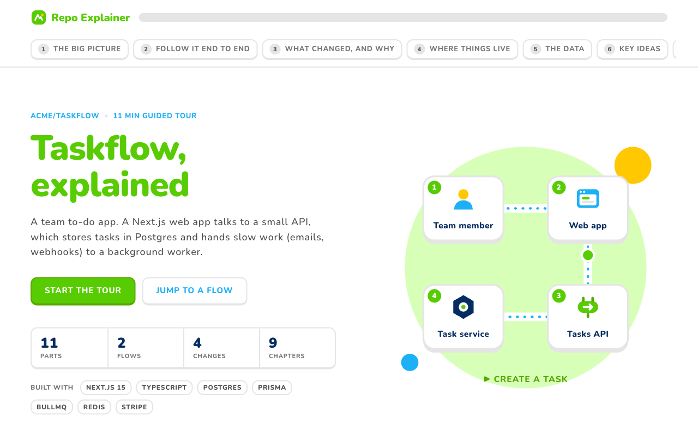
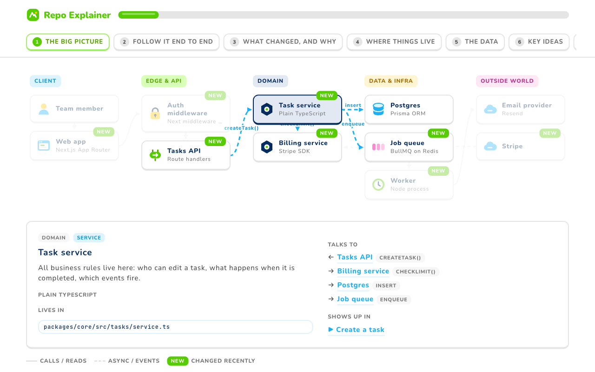
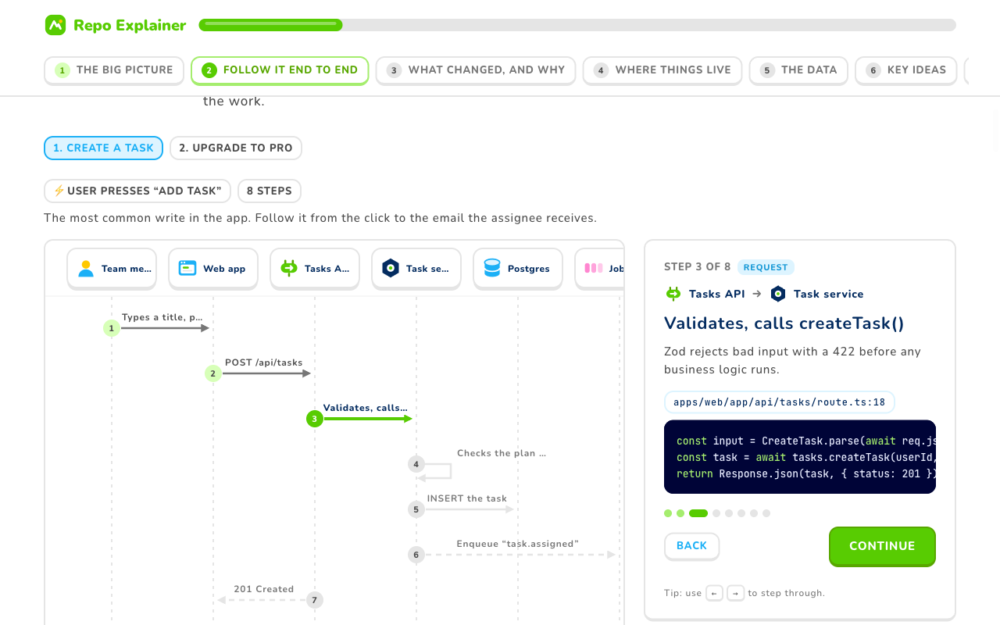
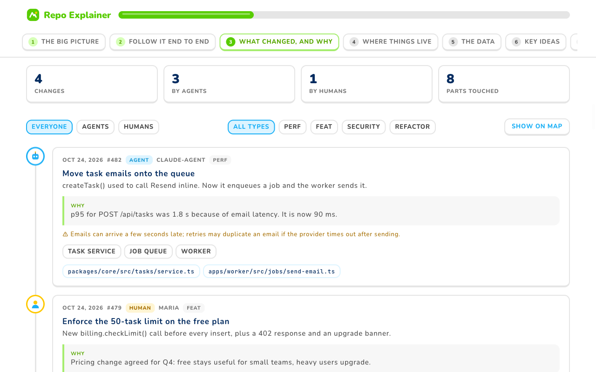
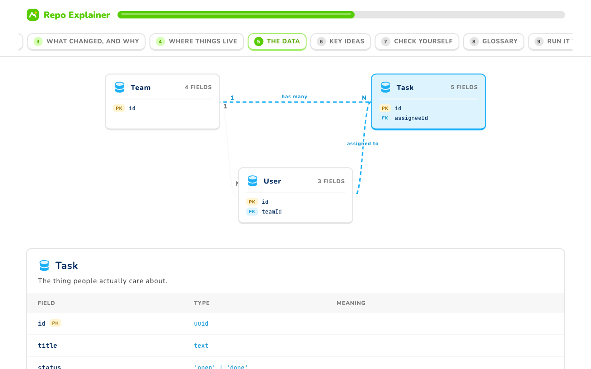
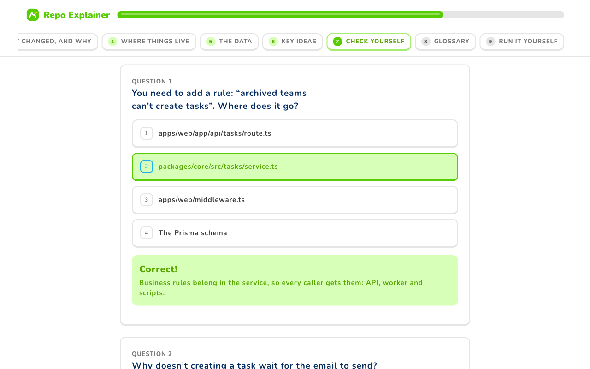

<p align="center">
  
</p>

<p align="center">
  <b>Turn any codebase into a guided, interactive tour.</b><br>
  An agent skill that maps the system, walks every request end to end, and shows what changed and why.
</p>

<p align="center">
  <a href="https://github.com/Cyvid7-Darus10/repo-explainer/actions/workflows/ci.yml"></a>
  <a href="LICENSE"></a>
  
  
</p>

<p align="center">
  <a href="https://cyvid7-darus10.github.io/repo-explainer/examples/taskflow.html"><b>Live demo</b></a>
  &nbsp;·&nbsp;
  <a href="https://cyvid7-darus10.github.io/repo-explainer/examples/gallery.html"><b>Design kit</b></a>
  &nbsp;·&nbsp;
  <a href="#quick-start"><b>Quick start</b></a>
  &nbsp;·&nbsp;
  <a href="#what-a-run-costs"><b>Cost</b></a>
</p>

<p align="center">
  <a href="https://cyvid7-darus10.github.io/repo-explainer/examples/taskflow.html"></a>
</p>

## Why

Understanding a repo used to mean reading it. A few people wrote the code, you knew who to ask, and the history told a story.

Picture a busy repo today. Twenty merge requests land in a day. Some come from engineers, many from coding agents working in parallel. The tests pass, but nobody holds the whole picture:

- **What is new** since you last looked?
- **Why was it added?** The reason sits in a PR description nobody will open again.
- **Who changed it:** a person you can ask, or an agent you can't?
- **How does a request flow now?** The wiki diagram is from last quarter.

Reading every diff does not scale. Repo Explainer has your agent do the reading, then **teach** the result like a good lesson: one idea at a time, diagrams you can click, and every claim linked to a real line of code.

## What you get

One self-contained HTML page per repo:

- **The big picture.** An architecture map. Click a part to see what it does, its files, and who it talks to.
- **End to end.** Step through each request on a sequence diagram with a Continue button. Every hop cites `file:line`.
- **What changed, and why.** Recent merges split by human and agent, each with its reason. **Show on map** lights up the parts that moved.
- **The data.** An ER diagram with cardinality, then a clear field table per entity.
- **Check yourself.** "Where would you change X?" questions with instant feedback.

Re-run it tomorrow and it only reads the new merges.

| | |
|---|---|
|  |  |
| **Start.** Reading time and the main route at a glance. | **Map.** Click a part to see its files, neighbours and flows. |
|  |  |
| **Flows.** One hop at a time, with the code that does it. | **Changes.** Agent or human, the reason, and the risk. |
|  |  |
| **Data.** Relationships first, then fields. | **Quiz.** Instant feedback, with the why. |

## Quick start

### As an agent skill

```sh
git clone https://github.com/Cyvid7-Darus10/repo-explainer ~/.claude/skills/repo-explainer
```

Then ask your agent:

> Explain this repo for a new engineer. Trace sign in and checkout end to end, and include what changed this week.

The agent follows [`SKILL.md`](SKILL.md). It scans the repo, picks a preset, traces flows through the real code, fills in `explainer.json`, and builds the page. Any agent that can read a skill file and run Node can use it.

### From the command line

```sh
npx github:Cyvid7-Darus10/repo-explainer scan ./my-repo
npx github:Cyvid7-Darus10/repo-explainer init ./my-repo
npx github:Cyvid7-Darus10/repo-explainer changes ./my-repo --data explainer.json --write --merges
npx github:Cyvid7-Darus10/repo-explainer build explainer.json --repo ./my-repo --strict --open
```

Needs Node 18.17 or newer. Nothing to install. The output is one HTML file you can commit, attach to a PR, or host anywhere.

<details>
<summary><b>All commands</b></summary>

| Command | What it does |
|---|---|
| `scan <repo>` | Stack, entry points, route handlers with `file:line`, data files, env var names (never values), scripts, and a suggested preset |
| `estimate [repo]` | Rough agent cost per run, per model |
| `init <repo> [--preset id]` | A starter `explainer.json` with `TODO`s to fill |
| `changes <repo> [--data f --write]` | Draft change entries from git: human or agent, type, PR link, parts touched |
| `validate <file> [--repo dir] [--strict]` | Check references, lesson shape, writing style, and that every cited file exists |
| `build <file> [--out f] [--repo dir]` | Validate, then render the page |
| `presets` | Presets for full stack, backend API, frontend, mobile, and library or CLI repos |
| `patterns [id]` | Reusable flow shapes: auth, webhook, async job, cache, and more |
| `gallery` | The design kit page |
| `assets` | Logo and icon SVGs |

</details>

## What a run costs

The agent does the costly part: reading code and writing the explainer. These are estimated costs **per run** at [Anthropic API prices](https://claude.com/pricing), checked October 25, 2026.

| Run | Fable 5.1 | Opus 5.5 | Sonnet 5.5 | Haiku 5.5 |
|---|---|---|---|---|
| Update (new merges only) | $0.95 | $0.44 | $0.22 | $0.014 |
| Small repo (under 300 source files) | $1.60 | $0.74 | $0.37 | $0.024 |
| Medium repo (300 to 2,000 files) | $3.65 | $1.82 | $0.91 | $0.32 |
| Large repo (over 2,000 files) | $9.50 | $5.00 | $2.50 | $0.93 |

- **Sonnet 5.5** is a good default.
- **Opus 5.5** pays off on large or unfamiliar systems.
- **Haiku 5.5** suits a daily "what changed" refresh.

These are estimates, not quotes. They assume most repeated context comes from the prompt cache. Real cost depends on how many flows you ask for and how much code the agent reads. Run `repo-explainer estimate ./my-repo` for your repo's size. On a Claude subscription, usage counts against your plan instead. The assumptions are in [`scripts/lib/estimate.mjs`](scripts/lib/estimate.mjs).

## Built to stay consistent

Agents only write data. The design, components, icons and motion are fixed and tested, so every explainer looks the same and readers learn it once.

- **One data contract**, checked on every build. See [`references/data-schema.md`](references/data-schema.md).
- **Presets and flow patterns** so agents start from a proven shape.
- **Writing rules:** gist first, short sentences, no filler. Enforced as warnings.
- **Design guardrail tests** fail CI on shadows, gradients, off-palette colors or `innerHTML`.
- **Truthfulness:** every part and step cites real files, and `--repo` checks they exist. Change reasons come from PRs and commits, never made up.

## Security and privacy

- The scanner reads env var **names** from example files only. It never opens `.env`.
- All repo text renders as plain text, and embedded data is escaped. Links must be `http` or `https`.
- The page makes no network calls except loading Google Fonts. It falls back to system fonts offline.

Report vulnerabilities through [SECURITY.md](SECURITY.md).

## Credits

- **Visual design** follows [Duolingo](https://www.duolingo.com)'s design language: the palette and its color names, the type scale, and the pressable buttons.
- **Lesson format** is inspired by [Brilliant](https://brilliant.org): one idea per step, with a Continue button.
- **Explanation design** draws on Bret Victor's [Explorable Explanations](https://worrydream.com/ExplorableExplanations/), Red Blob Games, and the C4 model.

Repo Explainer is independent and not affiliated with Duolingo or Brilliant. It includes none of their logos, mascots, illustrations or fonts. Type is [Nunito](https://fonts.google.com/specimen/Nunito) and [JetBrains Mono](https://www.jetbrains.com/lp/mono/). The icons are original.

## Contributing

Issues and pull requests are welcome. Read [CONTRIBUTING.md](CONTRIBUTING.md) and run `npm run check` before opening a PR.

## License

[Apache License 2.0](LICENSE). If you use or adapt this project, keep the [NOTICE](NOTICE) file, which credits Cyrus David Pastelero, as the license requires.
